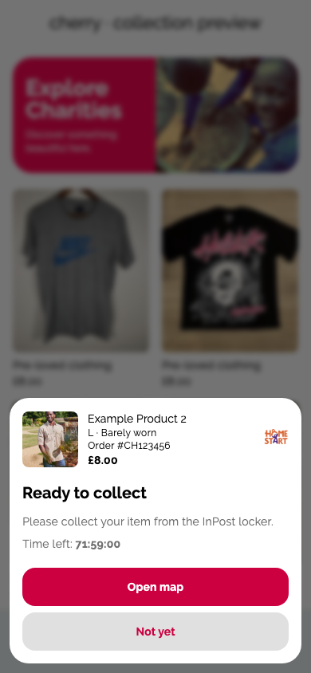
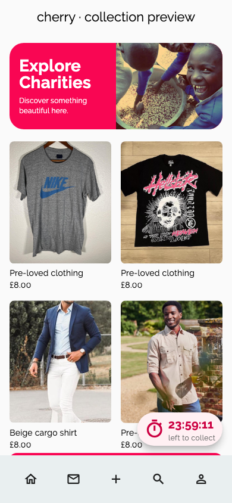

# Ready to collect: connected pop-up

The collection dialog now uses buyer order API data through the existing reminder host. It appears on entry or app resume when a stored arrival and collection deadline are available, then hands over to confirmation after customer collection. A separate local preview remains available for design review.



## Dependencies and scope

- Frontend PR #564: https://github.com/Cherry-CIC/MVP/pull/564. This branch is based on that PR and reuses its item summary and countdown formatter.
- Backend PR #74: https://github.com/Cherry-CIC/cherry-Backend/pull/74 supplies the confirmation foundation. [Backend PR #75](https://github.com/Cherry-CIC/cherry-Backend/pull/75), stacked on #74, adds arrival, deadline and locker details.
- This draft covers the pop-up and API integration. The collection Home countdown is included; push notifications remain separate work. The existing confirmation Home timer is preserved. Neither PR has been merged or deployed.

## Agreed 72-hour rule

On 6 November 2026 the product owner chose a flat 72-hour collection window from recorded locker arrival. `collectionDeadlineFromArrival` normalises the recorded arrival to UTC and adds 72 elapsed hours. The dialog accepts an absolute deadline. It never calculates a new window from the time it opens.

The companion backend persists the arrival and deadline across retries and app launches. The Flutter app reads these values and does not calculate a window when it opens. Keep Sendcloud's update-ordering timestamp separate from the carrier event timestamp. Do not use historical locker-arrival fields without checking their meaning.

InPost documents the usual 72-hour window and an exception for grouped parcels, where the window starts from its notification that everything is ready. The flat rule is an agreed MVP assumption, not a verified per-parcel deadline from Sendcloud. Follow-up integration must document this limitation and allow a future carrier deadline to take precedence.

Sources:
- https://inpost.co.uk/help/how-long-do-i-have-to-pick-up-my-parcel
- https://inpost.co.uk/blog/dont-ghost-your-parcels

## Dialog contract

`ReadyToCollectDialog` takes an `OrderSummary`, an absolute `collectionDeadline`, and optional `canOpenMap` / `canTrackParcel` flags. Both flags default to false. Enable them only when the caller has a real destination and can handle the returned action.

The returned `ReadyToCollectAction` is `openMap`, `trackParcel` or `dismiss`. Back and barrier dismissal return null. A dismissal must not confirm receipt. A map tap is rechecked against the deadline, including between timer ticks.

Before expiry, show Open map when available, otherwise Track parcel when available, plus Not yet. On expiry, replace the countdown with Collection window ended, optionally show Track parcel, and offer I understand. Expiry alone does not claim that the parcel was returned or alter the order status.

The host refreshes on entry/resume and every minute while Home or its dialog is visible. It replaces a changed dialog or removes one after cancellation, return or resolution. Concurrent fetches are guarded and backgrounded responses are invalidated. Collection-ready, collection-expired and confirmation dismissals use separate identities in per-buyer device preferences; legacy confirmation dismissals remain valid.

Map links use only the saved locker address, never the buyer's delivery address. Incomplete addresses hide the map action; a valid HTTPS tracking URL provides a fallback. Links open externally, and a failed launch offers a retry. See [Google Maps URLs](https://developers.google.com/maps/documentation/urls/get-started). Notification permissions are not involved in this flow. A later notification tap must refresh state before presenting any reminder.

Missing carrier arrival/deadline fields suppress the timed collection reminder. No historical arrival backfill or fresh 72-hour window is invented. Expired awaiting-collection orders receive neutral expiry copy, not an assertion that a return has occurred.

## Design and accessibility

Uses the supplied screenshot's bottom card, 24-pixel corners, blurred background, item details, charity logo and pink/grey buttons. The primary button uses the existing darker cherry action colour for white-text contrast. Content scrolls at large text sizes; controls have a minimum height of 48 logical pixels. The countdown has a spoken label and is not a live region. Product and charity images are decorative because the adjacent text supplies the item context.

The local preview uses sample data and bundled images. Its map/tracking actions show a preview message and do not navigate to a real parcel. Rendered images use the bundled Raleway font for reproducibility; the app retains its existing theme typography.

## Review and verification

Validation on 7 November 2026: 90 focused tests passed, including 12 new API/host integration tests; the render check passed for light, expired and dark states. Static analysis passed for all changed Dart files. The widget tests include 320-pixel width at 200% text, spoken countdown labels, tap targets and light/dark contrast. Physical screen-reader use is still outstanding.

Local validation used Flutter 3.44.4 / Dart 3.12.2. Offline dependency resolution adjusted four transitive test dependencies for this installed SDK; the repository lockfile was restored and no dependency changes are included.

Run from the isolated Flutter worktree:

```sh
flutter pub get
flutter test --no-pub test/ready_to_collect_dialog_test.dart
flutter test --no-pub test/delivery_reminder_test.dart test/home_orders_navigation_test.dart test/orders_repository_test.dart test/orders_view_model_test.dart test/orders_widgets_test.dart
flutter test --no-pub tool/render_collection_preview_test.dart
flutter run -d chrome -t tool/ready_to_collect_preview.dart
```

The render tool writes ready, expired and dark previews to `build/collection-preview/`. It makes no network or backend requests.

Live InPost events, external map/tracking launch on devices, physical-device layout, VoiceOver/TalkBack and the full deployed collection-to-confirmation lifecycle still need verification. Polling means foreground state may take up to a minute to refresh after the backend processes an event; push delivery is not included.


## Home timer (13 November 2026)

After dismissal, Home displays the earliest active collection or confirmation deadline in one tappable pill. Tapping reopens the matching order. Equal deadlines use order ID as a stable tie-breaker. Collection uses the pale-pink stopwatch design and “left to collect”; confirmation retains its existing wording. Dismissal and deadlines survive relaunch without restarting either window.

At zero, the timer disappears and requests fresh order data. Collection or return reported by the API takes precedence over an expiry notice. Background expiry waits for foregrounding before fetching. A failed refresh does not invent a shipment outcome. The timer stays above Home navigation and is hidden on other tabs.



Validation: all 110 focused Flutter tests pass; static analysis passes for all seven changed Dart files. Six visual previews pass, including light/dark timers and 320-pixel width with 200% text. A width constraint preserves screen margins at large text sizes. Physical-device and live-courier verification remain outstanding. No backend changes or push notifications are part of this stage.
