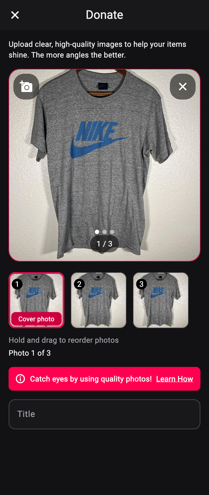
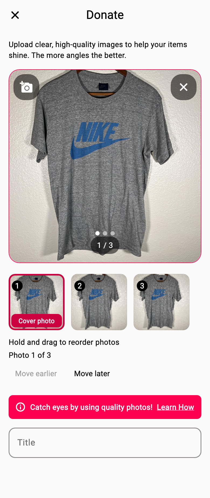

# Donation photos and camera permission

Donors can reorder local photos before submitting a new listing. Hold a thumbnail and drag it along the row. The instruction is shown in readable grey, without visible movement buttons. Screen-reader users can use the thumbnail's native reorder actions. The first photo is labelled **Cover photo**. Tapping a thumbnail changes the large preview; swiping the large preview still only changes the viewed photo.

The demonstration arrow from the design discussion is not part of the interface. Reordering is opt-in on the Donate screen. The existing listing editor retains its current photo controls.

## State and upload behaviour

- File paths identify photos during a move. The currently viewed photo stays selected even when its position changes.
- The thumbnail row scrolls to keep the selected photo visible. Longer rows can also be scrolled or dragged at their edges.
- Adding photos appends them without replacing the chosen order. Repeated paths within a gallery selection are ignored. Removing the cover promotes the next photo.
- Parent callbacks and donation requests hold immutable copies of the photo order. Clearing the form also clears the picker.
- Adding, removing and reordering are disabled during submission. Previewing remains available. Failed submissions retain the selected order and re-enable editing.
- The existing upload repository preserves the input order when constructing `product_images`, even if uploads finish in a different order. A failed upload prevents the product POST.
- No API contract, Firebase configuration, storage rules, Swagger, database schema or dependency changes are included. Server-side persistence of array order still needs a staging check.

## Camera permission

The shared photo picker checks the current device's camera permission before showing cherry's explanation. This applies to Donate and Edit listing > Add photos.

- Granted access opens the camera directly. There is no repeated explanation or permission request.
- Access that still needs a request shows the explanation first. Only Continue requests camera permission; cancelling leaves the selected photos unchanged.
- Permanently denied or restricted access uses the existing recovery guidance without opening the camera. The system remains responsible for granting or denying access.
- Permission is checked afresh for every explicit Take Photo action. Changes in Settings and revoked or temporary permissions are not cached. Returning from Settings alone does not launch the camera.
- No account preference or remembered approval is stored. Another device follows its own system permission status. Gallery selection does not check camera permission.
- The in-app camera messages and iOS camera usage description spell cherry with a lowercase c.

## Automated validation

Flutter 3.44.4 / Dart 3.12.2, based on `af876c5`:

```sh
flutter test --no-pub test/photo_upload_camera_permission_test.dart test/permission_strings_test.dart test/photo_upload_test.dart test/donation_photo_submission_test.dart test/donation_repository_photo_order_test.dart
flutter test --no-pub
flutter analyze --no-pub
bash tool/check_safe_logging.sh
```

All 27 focused tests pass: 13 photo-ordering tests, 13 camera-permission tests and the existing permission-copy test. They cover dragging, preview/cover consistency, screen-reader reordering, hint contrast, add/remove/clear, upload ordering, granted/denied/restricted permissions, Settings changes, revocation, cancellation and late responses after disabling or leaving the picker. Native permission channels are mocked in the tests.

The full suite has 422 passing tests and 18 failures. All 18 failures reproduce on untouched `af876c5` with the same SDK: one Create Account password visibility test and 17 product/profile tests. The baseline has 396 passing tests. Full analysis has the same 19 pre-existing findings as the baseline; analysis of the changed Dart files has no findings. The safe logging guard, diff whitespace checks and iOS property-list validation pass.

## Implementation previews

These are Flutter widget renders of the implemented photo controls at 390 logical pixels wide, using the existing application themes. They are not device captures. The repository's sample grey T-shirt image is repeated under three fixture paths to demonstrate the controls. Native fonts and system bars can differ.

| Dark theme | Light theme |
| --- | --- |
|  |  |

## Before release

These checks have not been performed on physical devices or the deployed backend:

- [ ] On iOS and Android, check first-use approval, repeated camera access after approval, cancellation, denial and Settings recovery. Revoke permission and check that the next Take Photo action rechecks it. Confirm the explanation spells cherry correctly.
- [ ] On iOS and Android, add distinct gallery and camera photos. Drag the last photo to the first position and back. Check that ordinary swiping still only changes the preview.
- [ ] Try enough photos to exceed the visible row. Hold near an edge to scroll while dragging. Verify the desired cover, counter and preview after each move.
- [ ] Add and remove photos after reordering, including removing the first and final photo. Cancel the picker and return to the form.
- [ ] Use VoiceOver/TalkBack to select thumbnails and move them using their native reorder actions (left/right or start/end). Confirm position announcements, focus, available boundary actions and the submission lock, larger text and light/dark contrast.
- [ ] Submit on staging. Confirm controls cannot change the photo set during upload. Reopen the listing and check its cover and full gallery order against the submitted selection.
- [ ] Simulate an upload failure. Confirm the order and form values remain available for retry.
- [ ] Smoke-test Edit listing > Add photos to confirm it keeps the existing editor flow and does not show the new Donate cover badge.

Native builds, device gesture/accessibility checks and live persistence are release verification tasks, not claims made by the automated tests.
