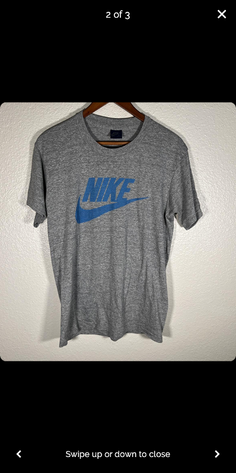

# Product photo viewer

Tapping a photo in the product detail header opens that photo in a full-screen viewer. The viewer uses the existing image sources and preserves their proportions without cropping. Swipe horizontally or use the previous/next buttons to browse. Swipe vertically, use the close button or use system Back to return to the existing product page, with its scroll position and original carousel selection preserved.

This is a UI change with widget tests. It does not change uploads, image storage, APIs, dependencies, listing actions or checkout. Pinch-to-zoom is outside this feature's scope.

## Preview



Widget-rendered preview at 400 × 800 using an existing repository image and the bundled Raleway font. This is not a device screenshot or verification of native system bars.

## Automated checks

```sh
flutter test --no-pub test/product_photo_viewer_test.dart test/product_self_like_test.dart test/home_product_navigation_test.dart test/edit_listing_navigation_test.dart
```

All 22 tests passed on Flutter 3.44.4 / Dart 3.12.2. The 13 new cases cover the selected photo and rendered image, horizontal and diagonal paging, dismissal in both vertical directions, cancelled short drags, labelled controls, system Back, failed images, empty/single-photo listings, large text, light/dark themes, portrait/landscape layouts and preservation of the underlying product page.

Analysis of the five changed Dart files passed without diagnostics. Whole-project analysis with `--no-fatal-infos --no-fatal-warnings` completed with 19 diagnostics in unchanged files.

Four additional failures were reproduced with the original `main` versions of every modified existing source file: one in `product_self_purchase_test.dart` and three in `profile_listing_details_navigation_test.dart`. All report a missing `IEditListingRepository` provider. These existing tests are unchanged by this PR.

The installed Flutter SDK could not enforce the committed lockfile. Local dependency resolution used `matcher 0.12.19`, `meta 1.18.0`, `test_api 0.7.11` and `vector_math 2.2.0`. The tracked lockfile was restored before checks, and checks used `--no-pub`. No dependency or platform project changes are included.

## Device checks before merging

These checks have not yet been performed on physical iOS/Android devices:

- Open your own listing and another seller's listing with several real uploaded photos. Select a later photo and confirm it opens first, in full.
- Browse portrait and landscape photos in both directions. Confirm slight diagonal movements do not accidentally close the viewer.
- Swipe up and down to dismiss. Confirm a short drag snaps back, and close/system Back leave you on the same product page.
- Check loading and unavailable photos on a slow connection. Confirm navigation and dismissal remain available.
- Check large text, device rotation, safe areas, status/navigation bars and VoiceOver/TalkBack announcements and controls.
- Confirm the product header's back, like and safety controls still perform their own actions.

Full native builds and the complete repository test suite were not run locally.
