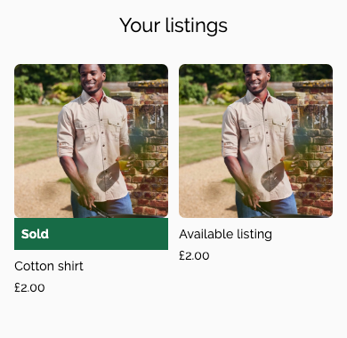
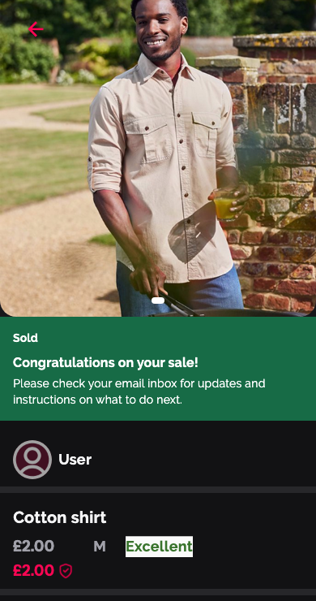

# Sold listing cards

This frontend change makes the existing API sale status visible on listing cards and product details. It includes UI and client basket logic. It does not change Firebase, payment handling or the API contract.

## Behaviour

- `Product` and `SellerListing` retain the API's `status` value. Only `status: "sold"` displays a sold notice. Missing, malformed and unknown statuses are not inferred from quantity.
- Profile cards show a bold white “Sold” label on a green strip beneath the photo. Their screen reader label includes the sold status.
- General product cards show the same strip within the image area to preserve the existing grid height. The like control moves above it and remains usable, including for removing a liked item.
- Full product details show the strip below the photo. The authenticated seller also sees “Congratulations on your sale!” and “Please check your email inbox for updates and instructions on what to do next.” Other viewers see only “Sold”.
- Sold details hide buying, editing, offers and other purchase-related controls. Eligible active listings keep the owner menu and editor from #548 and #525. `CheckoutViewModel.addItem` also rejects products already marked sold.
- The seller's status follows the existing Profile load/pull-to-refresh and product-detail fetch. This change does not add live status listeners or an opening pop-up.

The backend remains responsible for payment verification and stock protection. The UI cannot prevent a previously fetched active listing becoming sold elsewhere; the backend must still enforce availability during checkout.

## Contract and limits

The published API documents `active`, `unlisted` and `sold`, including the authenticated `/api/products/my-products` response. The backend sets `sold` when a paid purchase exhausts stock. Multi-quantity listings remain active until the last unit sells.

The backend also normalises legacy zero-stock records to `sold`. The frontend cannot distinguish those records from paid sales using status alone. This change displays the API state; it does not verify payment independently or claim that a donation has reached the charity. Email delivery was not tested.

Sources inspected on 26 October 2026:

- [Live API documentation](https://cherry-backend-401854471349.europe-west2.run.app/api-docs/)
- [Backend product status mapping](https://github.com/Cherry-CIC/cherry-Backend/blob/c3f436a901b377193fd8c01b8f76e30568150e81/src/modules/products/repositories/ProductRepository.ts)
- [Backend sale handling](https://github.com/Cherry-CIC/cherry-Backend/blob/c3f436a901b377193fd8c01b8f76e30568150e81/src/modules/order/repositories/OrderRepository.ts)

## Validation

239 targeted tests passed on the PR branch with main (`8850c35`) merged, using Flutter 3.44.4 / Dart 3.12.2, across:

- `sold_listing_test.dart`
- `profile_listings_widgets_test.dart`
- `profile_listings_repository_test.dart`
- `profile_listing_details_navigation_test.dart`
- `product_self_purchase_test.dart`
- `product_repository_test.dart`
- `product_self_like_test.dart`
- `checkout_view_model_test.dart`
- `core/services/network/safe_http_log_interceptor_test.dart`
- `edit_listing_navigation_test.dart`
- `edit_listing_repository_test.dart`
- `edit_listing_page_test.dart`
- `edit_listing_view_model_test.dart`
- `listing_cache_refresh_test.dart`
- `listing_actions_integration_test.dart`
- `delete_listing_dialog_test.dart`
- `delete_listing_view_model_test.dart`
- `deleted_listing_caches_test.dart`
- `product_deletion_repository_test.dart`

New coverage includes API decoding, malformed/missing status and zero stock, seller-only guidance, buyer controls, basket rejection, screen reader labelling, 200% text and WCAG AA colour contrast. Light and dark card/detail previews were rendered from Flutter widgets using test fixtures and checked visually.

`bash tool/check_safe_logging.sh` and `git diff --check` passed. `flutter analyze --no-pub` reported 19 existing findings in unrelated files, with no findings in the changed files.

The local SDK resolves four SDK-pinned transitive packages differently from the committed lockfile; no dependency changes are included in this PR.

The specific live sold item, physical devices and payment-to-email flow have not been tested. Before release, refresh the seller's Profile against a confirmed sold item, open it, verify the message and email instructions, and check that another account cannot start buying it. Confirm that an active listing retains its existing behaviour.

The opening pop-up and its acknowledgement storage remain a separate follow-up.

## Review previews

Rendered from the PR branch with test fixtures, not a live sale. Preview fonts use bundled fallbacks.

